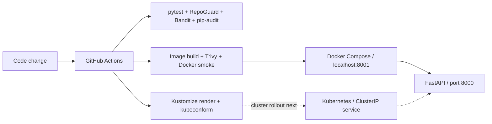

# Platform Engineering Lab

[](https://github.com/kev07hrndz-dot/platform-engineering-lab/actions/workflows/ci.yml)

**A small FastAPI service with a secure delivery workflow and a Kubernetes deployment scaffold.** Built by Kevin Hernandez to demonstrate practical Platform Engineering and DevSecOps decisions through code that is easy to inspect and run.

## Review in 30 seconds

- **Application:** FastAPI with API tests, health/readiness endpoints, and OpenAPI documentation.
- **Containers:** non-root UID 10001, a read-only filesystem, dropped capabilities, and a digest-pinned Python base image.
- **CI/security:** GitHub Actions runs tests, RepoGuard, Bandit, dependency audits, container scans, and a Docker smoke test.
- **Kubernetes/IaC:** declarative Kustomize manifests with probes, resource limits, restricted security contexts, and NetworkPolicy; schema checks in CI.
- **Next milestone:** prove a local Kubernetes rollout, then package the same application with Zarf and integrate with UDS Core.

**Scope:** this is a learning portfolio. The application, checks, container configuration, and Kubernetes manifests are implemented. Kubernetes runtime validation, UDS/Zarf delivery, and AWS/Terraform provisioning are future work. No production, compliance, or air-gap deployment is claimed. Use the linked [Actions runs](https://github.com/kev07hrndz-dot/platform-engineering-lab/actions) to inspect the current validation results.

## Architecture



CI validates changes; it does not publish an image or deploy a cluster. The API has no database, external services at runtime, or privileged infrastructure access.

## Run locally

### Python

Requires Python 3.13. Run these commands from the repository root:

```bash
python3.13 -m venv .venv
source .venv/bin/activate
python -m pip install -r requirements-dev.txt
make check
python -m uvicorn app.main:app --host 127.0.0.1 --port 8000
```

Open [API docs](http://127.0.0.1:8000/docs) or check the service from a second terminal:

```bash
curl --fail http://127.0.0.1:8000/health
curl --fail http://127.0.0.1:8000/ready
```

Individual checks are also available:

```bash
python -m pytest
python security/repo_guard.py .
python -m bandit -r app security
python -m pip_audit -r requirements.txt
```

### Docker

Requires a running Docker engine; on macOS, start Docker Desktop.

```bash
docker info
docker compose up --build -d
curl --fail http://127.0.0.1:8001/health
curl --fail http://127.0.0.1:8001/ready
docker compose exec -T api id
docker compose ps
```

The container listens on 8000; Compose exposes it only on `127.0.0.1:8001`. This keeps Python development on port 8000 available. See [interactive docs](http://127.0.0.1:8001/docs), follow logs with `docker compose logs -f api`, and stop it with `docker compose down`. Rebuild after changing application code or dependencies. The final image removes pip and its ensurepip bootstrap after installation, including their unused vendored libraries; dependency changes happen through an image rebuild.

```bash
make docker-smoke
```

The smoke test uses a separate Compose project and a random local port, then cleans up. It checks real HTTP responses and verifies UID 10001, dropped capabilities, no new privileges, and a read-only root filesystem inside the running container.

### Kubernetes

Start with the [Kubernetes guide](deploy/kubernetes/README.md) for rendering, local image setup, deployment, verification, and cleanup. `make k8s` renders the manifests; CI additionally checks their Kubernetes schemas. A render/schema pass does not prove a successful rollout or NetworkPolicy enforcement.

## API contract

| Endpoint | Purpose |
| --- | --- |
| `GET /` | Project welcome and application status |
| `GET /health` | Liveness: the application responds |
| `GET /ready` | Readiness: this stateless application can serve traffic |
| `GET /info` | Developer, project, and engineering focus |
| `GET /docs` | Interactive OpenAPI documentation |

Readiness currently has no upstream services to inspect. If a database or dependency is added, the readiness contract must change with it.

## Threats and security controls

| Threat | Implemented control | Boundary / remaining work |
| --- | --- | --- |
| Credentials committed to source | [RepoGuard](security/repo_guard.py) reports file, line, and issue without printing matched values; CI fails on findings | Heuristic detection can miss secrets or flag examples; scans the working tree, not Git history |
| Unsafe Python code or vulnerable dependencies | Bandit and pip-audit in [CI](.github/workflows/ci.yml); pinned requirements | Static checks and advisory databases are incomplete; pins still need updates |
| Excessive container privileges | [Dockerfile](Dockerfile) uses UID/GID 10001; [Compose](compose.yaml) drops capabilities, prevents privilege escalation, and uses a read-only root filesystem | Containers share the host kernel; these controls do not provide a complete isolation boundary |
| Vulnerable or misconfigured images | Digest-pinned base image; Trivy image and configuration checks | Image gate blocks HIGH/CRITICAL vulnerabilities with fixes; unfixed vulnerabilities can remain |
| Unhealthy workloads or resource exhaustion | [Kubernetes manifests](deploy/kubernetes/) define probes and resource requests/limits | Actual scheduling, rollout, and failure behavior still need cluster validation |
| Unnecessary cluster/network access | Restricted workload settings, disabled service account token mounting, and NetworkPolicy | NetworkPolicy requires an enforcing CNI; ingress and TLS/authentication need an explicit platform design |

See the [security design](docs/security.md) for assumptions and verification boundaries. The API intentionally exposes only demonstration responses. Authentication, authorization, TLS termination, observability, image signing, and a production operational model remain work to do before handling sensitive data or public traffic.

## Skills demonstrated

| Skill | Inspectable evidence |
| --- | --- |
| Python API development | [FastAPI routes](app/main.py), [API tests](tests/test_api.py) |
| Linux/container security | [Dockerfile](Dockerfile), [Compose runtime restrictions](compose.yaml) |
| Security tooling | [RepoGuard implementation](security/repo_guard.py), [scanner tests](tests/test_repo_guard.py) |
| CI/CD foundations | [GitHub Actions gates](.github/workflows/ci.yml), [repeatable local commands](Makefile); deployment automation is a next step |
| Kubernetes and declarative infrastructure | [Kustomize deployment scaffold](deploy/kubernetes/) and its [operating guide](deploy/kubernetes/README.md) |
| Threat modeling and technical communication | Security control table above and [Kevin's Spanish learning guide](docs/learning-guide.md) |

Cloud provisioning and Terraform are roadmap items, not demonstrated implementations.

## Roadmap toward Zarf and UDS

The next steps build on the same small service instead of adding unrelated tools.

| Step | Deliverable | Evidence needed to call it complete |
| --- | --- | --- |
| 1. Prove Kubernetes runtime | Deploy the current image in a local test cluster with an enforcing CNI | Ready rollout, real endpoint responses, non-root identity, and allowed/denied network tests |
| 2. Package with Zarf | A versioned package carrying the image and Kubernetes resources | Package build, artifact inspection, and deployment with required resources available offline |
| 3. Integrate with UDS Core | Application `Package` custom resource and a small UDS bundle | Successful local integration, verified platform networking/identity/monitoring, and documented version compatibility |
| 4. Add supply-chain evidence | SBOM, signed artifacts, and verification before deployment | Stored artifacts and a failing verification test for an untrusted artifact |
| 5. Evaluate cloud IaC | A minimal Terraform AWS environment with a cost/cleanup plan | Reviewed plan, tested apply/destroy, and documented access boundaries |

[Zarf](https://docs.zarf.dev/) packages software and its dependencies for disconnected delivery. [UDS separates delivery from platform integration](https://docs.defenseunicorns.com/core/v1-13/concepts/configuration--packaging/overview/): the UDS Operator reconciles application requirements from custom resources. A [UDS bundle](https://docs.defenseunicorns.com/core/v1-13/concepts/configuration--packaging/bundles/) groups versioned Zarf packages and environment configuration. These are design references for future work; this repository does not yet contain or validate a Zarf package or UDS bundle.
